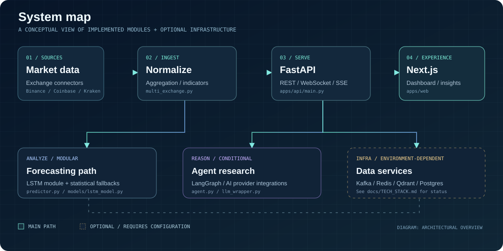

<div align="center">

<a href="https://sentinance.vercel.app" title="Explore Sentinance">
  
</a>

### SENTINANCE / THE SIGNAL ATLAS

**A market-intelligence engineering project exploring how raw exchange data becomes structured signals, model outputs and AI-assisted analysis.**

[](https://sentinance.vercel.app)
[](#-the-system-map)
[](docs/PORTFOLIO_CLAIMS.md)

<sub>The hero is a conceptual illustration, not live prices or a trading recommendation.</sub>

</div>

---

## 01 / The problem: markets generate noise

Exchange feeds arrive continuously. Indicators and forecasts create more signals, while analysts still need a way to interpret them and understand **which parts of a conclusion are measured, modeled or generated**.

Sentinance explores one connected engineering answer: normalize market information, expose it through consistent APIs, add analytical and AI-assisted paths, then present it through a fast, readable dashboard.

> **Design principle:** Separate the observed market data from the system's predictions and AI-generated interpretations.

## 02 / The system map

<div align="center">



<sub>Architectural overview: some external services are optional, configured or run with mock fallbacks. See the integration inventory below.</sub>

</div>

### Four stages, one story

| Stage | Responsibility | Evidence |
| :--- | :--- | :--- |
| **01. Capture** | Work with market connectors and external feeds | [Multi-exchange aggregation](apps/api/multi_exchange.py) |
| **02. Analyze** | Calculate technical indicators and investigate forecasting approaches | [Indicators](apps/api/indicators.py) · [Prediction API](apps/api/predictor.py) |
| **03. Reason** | Explore LangGraph orchestration, LLM fallbacks and retrieval | [Agent](apps/api/agent.py) · [RAG service](apps/api/rag_service.py) |
| **04. Explain** | Surface insights in dashboard and asset interfaces | [Next.js frontend](apps/web/src/app) · [API routes](apps/api/main.py) |

## 03 / Explore the experience

<table>
<tr>
<td width="50%" valign="top">

### 📡 Signal terminal

Work with normalized market feeds, WebSocket price updates and technical indicators. The application is designed to degrade gracefully when a provider is unavailable.

**Explore:** [Demo interface](https://sentinance.vercel.app/demo) · [Data integration docs](docs/WORKFLOW_MAP.md)

</td>
<td width="50%" valign="top">

### 🧠 AI research desk

Explore the separation of language-model commentary, retrieval, agent orchestration and measured or model-produced signals.

**Explore:** [Agent module](apps/api/agent.py) · [System decision](docs/adr/002-langgraph-for-ai-agent.md)

</td>
</tr>
<tr>
<td width="50%" valign="top">

### 📈 Forecasting lab

Investigate LSTM-based prediction pathways alongside indicators, backtesting and fallback behavior. Forecasts are experimental outputs, not guarantees.

**Explore:** [Prediction module](apps/api/predictor.py) · [ML architecture decision](docs/adr/009-lstm-price-prediction.md)

</td>
<td width="50%" valign="top">

### 🛠️ Engineering observatory

Review how backend services, test suites, container configurations and monitoring templates fit together.

**Explore:** [CI workflows](.github/workflows) · [Infrastructure](infra) · [Architecture decisions](docs/adr)

</td>
</tr>
</table>

## 04 / Capability truth table

This repository includes real implementation code **and** infrastructure that is optional, local-first, configured or simulated. These should not be confused with a fully running hosted stack.

| Capability | Repository-level status | Where to verify |
| :--- | :--- | :--- |
| Next.js web experience / FastAPI endpoints | Implemented in source | [Web](apps/web) · [API](apps/api) |
| Price WebSocket and technical indicator paths | Implemented in source; availability depends on data providers | [API modules](apps/api) |
| Gemini / Groq model responses | Provider-dependent; mocked fallback documented | [Stack inventory](docs/TECH_STACK.md) |
| LangGraph research orchestration | Agent code exists; mock-agent paths documented | [Agent](apps/api/agent.py) |
| LSTM prediction / PyTorch | Optional model; mock predictions documented | [Forecasting](apps/api/predictor.py) |
| PostgreSQL, Qdrant, Kafka, MLflow and Kubernetes | Mix of local/configured integrations, not proof of hosted operation | [Integration status](docs/TECH_STACK.md) · [Infrastructure](infra) |
| Tests / code coverage | Suites exist; **current pass count and coverage not independently verified here** | [API tests](apps/api/tests) · [Web tests](apps/web/src/__tests__) |

**Testing note:** Historical README figures are not live badges. Run the suites below or review the latest CI results before citing accuracy, latency, pass counts or coverage.

## 05 / Technology layers

| Layer | Technology |
| :--- | :--- |
| Frontend | Next.js 16, React 18, TypeScript, Tailwind CSS |
| APIs and streaming | Python, FastAPI, WebSocket, SSE |
| Analytics and ML | NumPy, PyTorch, LSTM forecasting, technical indicators |
| AI / retrieval | LangGraph, Gemini/Groq integrations, Qdrant (optional/fallback) |
| Data services | PostgreSQL, Redis, Kafka, dbt (availability varies by environment) |
| Platform | Docker, GitHub Actions, Kubernetes and monitoring configurations |

For precise package versions and whether a dependency is live, simulated or merely configured, use the [technical integration inventory](docs/TECH_STACK.md).

## 06 / Run the system locally

**Prerequisites:** Git, Node.js compatible with the current Next.js version, Python 3.10+ and optionally Docker. Refer to [setup documentation](docs/SETUP.md) and the repository's example environment files.

```bash
git clone https://github.com/HuLaxx/Sentinance.git
cd Sentinance
cp .env.example .env

# Optional: start local infrastructure
docker compose -f docker-compose.dev.yml up -d

# API (separate terminal)
cd apps/api
python -m venv .venv
source .venv/bin/activate
pip install -r requirements.txt
uvicorn main:app --reload --port 8000

# Web (another terminal, from repo root)
cd apps/web
npm install
npm run dev
```

On Windows, activate the Python virtual environment with `.venv\Scripts\activate`. Configure environment variables locally and **never commit real secrets**. External integrations may require credentials, a trained model and running infrastructure.

Useful local endpoints (when corresponding services are running): [Web](http://localhost:3000) · [FastAPI docs](http://localhost:8000/docs) · [API health](http://localhost:8000/health).

### Testing

```bash
# From repository root
cd apps/api
python -m pytest tests/ -q

# In a separate shell
cd apps/web
npm run test -- --run
```

Tests have not been executed as part of this presentation-only README update. Do not treat the commands as a verified green build.

## 07 / Engineering decisions

Great technical work is easier to trust when it shows **why** trade-offs were made.

- [Streaming and event decisions](docs/adr/004-kafka-for-event-streaming.md)
- [Graceful degradation and provider fallbacks](docs/adr/005-graceful-degradation.md)
- [LSTM forecasting approach](docs/adr/009-lstm-price-prediction.md)
- [Data lineage](docs/data_lineage.md)
- [System workflow and integration detail](docs/WORKFLOW_MAP.md)
- [Deployment options and limits](docs/DEPLOYMENT.md)

## 08 / Maturity and next steps

- [x] Maintain real source modules, API routes, local infrastructure and ADRs.
- [x] Publish a conceptual system map and original animated Signal Atlas artwork.
- [x] Make optional/mock integrations explicit in the main README.
- [ ] Run the current test suites and publish reproducible status/coverage in CI.
- [ ] Verify production demo features against local stack capabilities.
- [ ] Replace conceptual preview imagery with labeled real screenshots or recorded product walkthroughs.
- [ ] Document concrete evaluation datasets and reproducible forecasting results before publishing numerical performance claims.

---

<div align="center">

### From market noise to engineering clarity.

[**Open demo**](https://sentinance.vercel.app) · [**Portfolio**](https://portfolio.hulax.uk/) · [**GitHub**](https://github.com/HuLaxx) · [**LinkedIn**](https://www.linkedin.com/in/rahul-khanke-853717218/)

<sub>Built by Rahul Khanke / HuLaX · A technical portfolio project, not financial advice.</sub>

</div>
